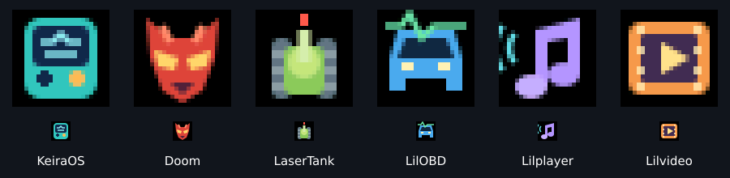

# SD application names and icons



Place these sidecars beside a guest firmware binary:

```text
/sd/lilvideo/lilvideo.bin
/sd/lilvideo/app.json
/sd/lilvideo/icon.rgb565
/sd/lilvideo/icon.png
```

```json
{
  "schema": 1,
  "name": "Lilvideo",
  "firmware": "lilvideo.bin",
  "icon": "icon.rgb565"
}
```

Applications still lists remembered multiboot shortcuts, most recent first.
Launch a new firmware from File Manager once to register it. Keira reads metadata
when building the menu at startup; restart Keira after updating sidecars.

The optional UTF-8 name is limited to 48 bytes with no control characters.
Metadata is at most 1024 bytes; its schema and firmware basename must match.
The icon filename must be a single local filename, never a directory or URL.
Native icons contain exactly 24×24 little-endian RGB565 pixels (1152 bytes).
Black pixels use the existing menu's transparent background behavior.
The PNG is a maintainer preview; Keira does not decode it.

Missing or invalid metadata uses the existing filename/default icon. A valid name
can still be shown when its icon is absent or invalid. Icon pixels belong to the
launcher, remain stable while menus use them, and are read only at menu creation.
At most 20 shortcut records are retained; native pixel storage is bounded to
23040 bytes plus names/vector overhead. No SDK or guest-firmware runtime changes
are required.

The compile-all runner archives and deploys metadata with its matching app binary.
Each repository keeps editable `app-icon.svg`, generated `icon.png` and
`icon.rgb565`, plus `app.json`. KeiraOS also ships assets for consistent packaging,
but normal compile-all deployment flashes it as the OS rather than adding itself
as a guest shortcut.
