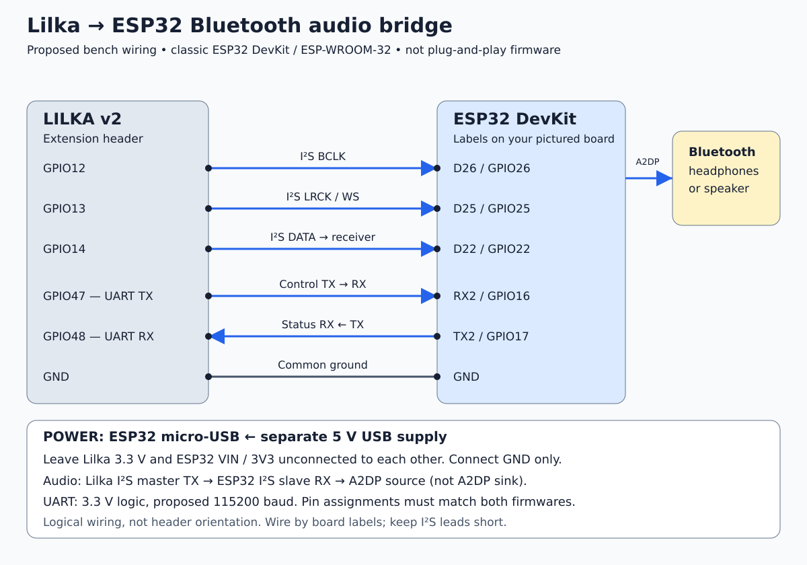

ESP32 Bluetooth audio bridge: proposed PoC
=========================================

Status: proposed, not implemented or bench-verified.
First reference device for :doc:`sd_device_drivers`.

Goal and hardware
-----------------

Send Keira's stereo PCM audio to Bluetooth headphones or speakers through an
external classic ESP32 / ESP-WROOM-32 DevKit-style board. The supplied board
photo shows micro-USB and RX2/TX2 header labels. Verify the delivered board's
pinout before wiring. ESP32-S3 is not a substitute for this Bluetooth Classic
bridge.

Reuse the existing SD ELF loader for a persistent Keira audio driver. The
external ESP32 needs separately flashed firmware implementing an I2S receiver
and Bluetooth Classic **A2DP source**. Headphones/speakers are A2DP sinks.
An A2DP sink example on the ESP32 implements the opposite direction.

Download the :download:`vector wiring diagram <images/bluetooth_audio_wiring.svg>`.
This is a logical connection diagram, not physical connector orientation.

Proposed wiring
---------------

.. list-table:: Wire by GPIO labels, not connector position
   :header-rows: 1
   :widths: 25 25 50

   * - Lilka v2 extension
     - ESP32 board label
     - Function
   * - GPIO12
     - D26 / GPIO26
     - I2S BCLK: Lilka output, ESP32 input
   * - GPIO13
     - D25 / GPIO25
     - I2S LRCK / WS: Lilka output, ESP32 input
   * - GPIO14
     - D22 / GPIO22
     - I2S PCM data: Lilka output, ESP32 input
   * - GPIO47
     - RX2 / GPIO16
     - Keira control UART TX to bridge RX
   * - GPIO48
     - TX2 / GPIO17
     - Bridge status UART TX to Keira RX
   * - GND
     - GND
     - Common ground

GPIO47/48 are remapped UART pins, not the extension pins marked TX/RX.
D25/D26 are digital clock inputs here, not analog DAC outputs. Keep programming
UART TX0/RX0 free and avoid flash pins D0/D1/D2/D3/CMD/CLK. Keep I2S wires short
with a nearby ground. This mapping conflicts with the proposed FM module on
GPIO12–14; do not use both mappings concurrently.

Power: bench versus intended final module
----------------------------------------

* **Initial bench PoC:** power ESP32 through micro-USB from a separate 5 V USB
  supply. Power Lilka normally and connect grounds only between supply systems.
  Leave Lilka 3.3 V disconnected from ESP32 VIN and 3V3.
* **Intended integrated module:** Lilka extension 3.3 V to ESP32 **3V3**, not VIN,
  conditional on measured regulator headroom, Bluetooth peak demand and rail
  stability under representative Lilka workloads. This is not yet approved as
  electrically qualified wiring.
* Inspect the actual DevKit regulator/USB topology before combining external
  3.3 V with USB programming power. Prevent backfeeding and signals into an
  unpowered board; disconnect or quiesce the link before independent shutdown.
* If Lilka's rail is insufficient, revise the power architecture explicitly.
  A separate regulator needs a suitable upstream supply; adding one to the same
  overloaded 3.3 V rail does not create additional power capacity.

Firmware and first milestone requirements
-----------------------------------------

* Lilka: I2S master transmitter. ESP32: I2S slave receiver. Proposed starting
  format: standard I2S, 16-bit stereo, 44.1 kHz; one data line carries both
  channels. No MCLK is proposed. Agree slot format and alignment on both ends.
* Bridge firmware must buffer PCM, handle the independent Bluetooth consumption
  rate/clock mismatch and report overflow/underflow. Define bounded latency and
  memory budgets before implementation; do not silently drop one channel.
* UART: proposed 115200 baud, 8N1, 3.3 V logic. Define a versioned, framed protocol
  with request IDs, timeouts and bounded payloads for discovery, pairing,
  connection, disconnect, capabilities and status/errors. Protocol is not yet
  implemented.
* Keira: persistently load the configured driver from SD, register a stable
  Bluetooth output ID and route audio through the shared PCM interface.
* Settings: select Built-in speaker / Bluetooth; discover/select a peer,
  pair/connect, reconnect to the remembered peer and show connection status.
  Specify initial supported pairing method before choosing reference peers.
* Missing module, version mismatch or reported link failure must leave a usable
  built-in output. Output switching must respect the active audio producer's
  ownership. Do not automatically blast failed Bluetooth playback through the
  speaker without a documented user-facing fallback policy.
* Keep drivers and transfers quiescent before unload; stop or safely switch audio
  before releasing I2S/UART resources. No arbitrary UART command execution.

PoC acceptance checks
---------------------

1. Separately identifiable left/right test audio reaches the correct headphone
   channels, with no accidental mono conversion.
2. Pair/connect and remembered-peer reconnection work with at least one named
   real Bluetooth device; report firmware versions and negotiated audio format.
3. Keira can select built-in/Bluetooth output and play representative in-tree
   PCM producers without hardcoded pin restoration or concurrent I2S ownership.
4. Repeated disconnect/reconnect, missing bridge, protocol mismatch and reported
   transfer errors produce bounded recovery and understandable status.
5. Record end-to-end latency, buffer behavior and extended playback stability.
   Bluetooth latency is expected; do not promise wired-equivalent game audio.
6. Before integrated power is accepted, measure idle/streaming/peak demand and
   3.3 V stability with Lilka under load; verify reset, shutdown and USB behavior.

Deferred: external displays, simultaneous outputs, hot-plug guarantees, custom
Bluetooth codecs, headset microphone/call profiles and enclosure design.
This document does not authorize firmware builds, flashing or dependency
installation; those remain separate implementation actions.

Evidence: user-supplied board photo, local Lilka extension documentation and
the existing SDK/Keira loader and audio implementation. No online datasheet
verification or physical test results are claimed.
